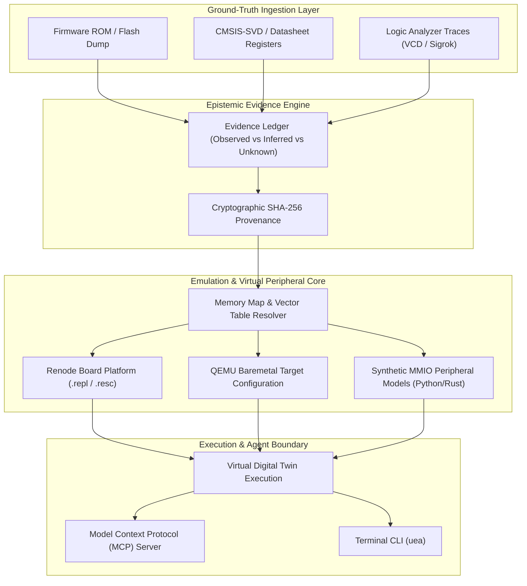

# UEA — Universal Emulation Anything ⚡🔬

> **Autonomous Silicon Digital Twin, Microcontroller Firmware Virtualization, and Hardware Bus Emulation Engine.**

UEA is an industrial-grade systems virtualization engine designed to give AI agents the ability to analyze, simulate, and interact with **bare-metal firmware, SoC peripherals, and physical hardware buses** without needing physical silicon, oscilloscopes, or soldering irons.

---

## ⚡ Architecture



---

## 🚀 Key Capabilities

- **CMSIS-SVD Silicon Deconstruction**: Parses XML/JSON CMSIS-SVD chip definitions across ARM Cortex-M0/M3/M4/M7, RISC-V, and ESP32, extracting bit-exact register offsets, reset values, access permissions, and interrupt vectors.
- **VCD Logic Analyzer Bus Decoding**: Ingests Value Change Dump (`.vcd`) waveform traces from Sigrok/Saleae, decoding SPI, I2C, and UART state transitions and payload packets with timestamp precision.
- **Autonomous Digital Twin Synthesis**:
  - Automatically generates complete **Renode platform descriptions (`.repl`)** and **startup scripts (`.resc`)**.
  - Synthesizes synthetic memory-mapped I/O (MMIO) peripheral stubs to satisfy firmware register checks (e.g. clock stabilization bits, PLL lock flags).
- **Epistemic Evidence Architecture**: Follows REA's ground-truth model. Differentiates verified observations from inferred clock speeds and unknown peripheral registers.
- **Built-in Model Context Protocol (MCP)**: Plugs directly into Antigravity, Claude Code, Cursor, and Windsurf, enabling AI agents to boot and test firmware autonomously.

---

## 🛠️ CLI Usage

### 1. Parse Silicon SVD Register Map
```bash
npx uea svd stm32f407.svd --peripheral USART1
```

### 2. Decode Logic Analyzer VCD Waveform Trace
```bash
npx uea vcd i2c_capture.vcd --protocol i2c --sda 0 --scl 1
```

### 3. Synthesize Renode Digital Twin
```bash
npx uea renode firmware.bin --svd stm32f407.svd --arch arm-cm4 --output ./virtual_board
```

### 4. Run MCP Server
```bash
npx uea mcp
```

---

## 🤖 MCP Tools for AI Agents

| Tool | Description |
|---|---|
| `parse_silicon_svd` | Ingests CMSIS-SVD files and extracts peripheral registers, bitfields, and vector tables. |
| `decode_vcd_bus_trace` | Decodes logic analyzer VCD files into structured bus packets (I2C/SPI/UART). |
| `synthesize_digital_twin` | Synthesizes complete Renode platform definitions, startup scripts, and MMIO stubs. |
| `inspect_memory_map` | Validates firmware entrypoints, stack pointers, and interrupt vectors from raw binaries. |

---

## 📄 License
Apache-2.0
